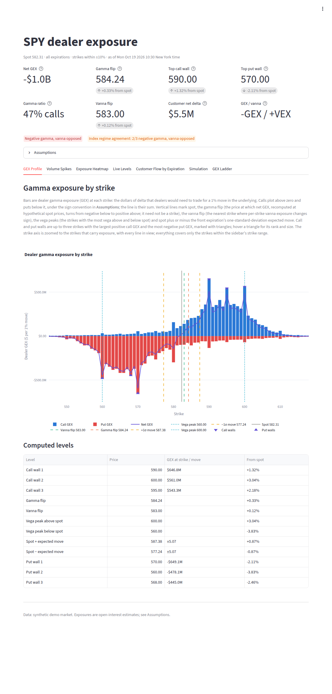
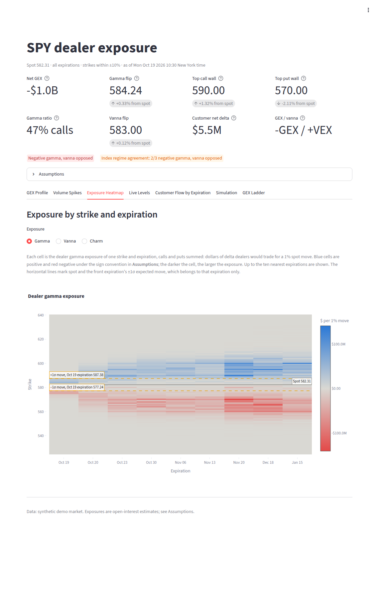
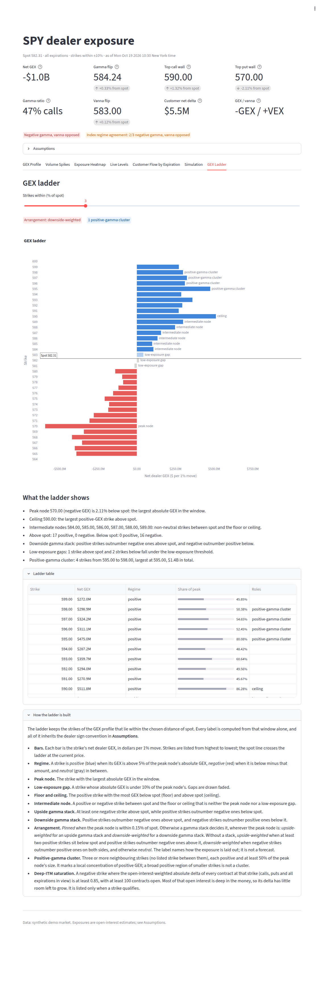
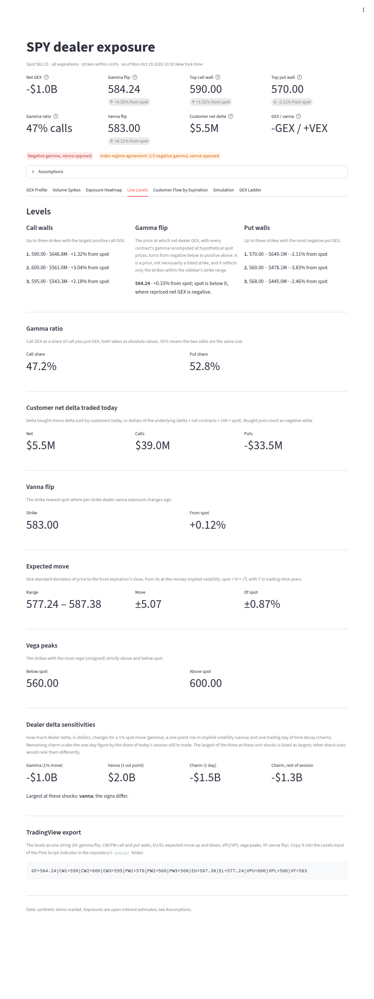
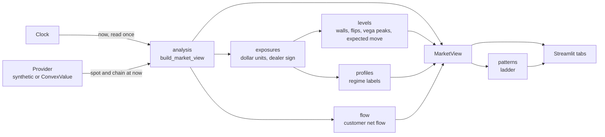

# gex-dashboard

[](https://github.com/scottmcghee/gex-dashboard/actions/workflows/ci.yml)


A Streamlit dashboard that estimates dealer gamma, vanna and charm exposure
from a single option-chain snapshot. It takes one row per contract (greeks,
implied volatility, open interest and, where the source has it, the customer
buy/sell split), converts each greek into dollar exposure in one place, and
derives per-strike profiles and price levels from them: call and put walls, a
gamma flip found by repricing gamma at hypothetical spot prices, a vanna flip,
vega peaks and the one-standard-deviation expected move. Data comes through a
small provider protocol. The default provider is a seeded synthetic market on
a replay clock, so the whole dashboard, including same-day (0DTE) expirations,
works offline and at any hour.

*Python 3.12+, Streamlit, pandas, NumPy, SciPy, Plotly, Docker. Unit tests,
a contract test suite every provider must pass, and Streamlit `AppTest` tests
of the whole app; no test touches the network.*



| Exposure Heatmap | GEX Ladder | Live Levels |
|---|---|---|
|  |  |  |

More: [Volume Spikes](docs/images/volume_spikes.png),
[Customer Flow by Expiration](docs/images/customer_flow.png),
[Simulation](docs/images/simulation.png).

## Design highlights

- **Units are converted in one place.** Providers return per-share greeks in
  documented units; `exposures.py` alone turns them into dollars (GEX in
  dollars of delta per 1% move), so every chart, card and level uses the
  same scale. See [DESIGN.md](docs/DESIGN.md#dollar-units).
- **A gamma flip by repricing, not by scanning strikes.** Every contract's
  gamma is recomputed with Black-Scholes-Merton across spot ±10%, and the
  flip is the price at which net GEX crosses zero. It is a price, not
  necessarily a listed strike, and it agrees with net GEX at spot by
  construction.
- **One book per view.** Every figure covers the same contracts: those
  within the chosen strike range whose expiration has not yet closed.
- **One assumption, stated once.** Dealer signs come from a single
  constant (long calls, short puts), and the UI's Assumptions panel says so.
- **Time is injected.** Every time-dependent calculation reads a `Clock`, and
  time to expiry is counted in trading minutes, so 0DTE options have a
  meaningful T and the demo can replay a session at any hour.
- **Capabilities, not provider names.** A provider declares what it supplies
  (several expirations, vanna and charm, customer flow); a tab that needs
  something missing says so instead of breaking.

## Try it in one command

You need Docker:

```bash
git clone https://github.com/scottmcghee/gex-dashboard.git
cd gex-dashboard
docker compose up
```

Then open http://localhost:8501. The first start builds the image, which
takes a minute or two. There is no database and no API key: the app runs on
the synthetic market, replaying one trading session in a loop. After
pulling changes, `docker compose up --build` rebuilds the image. `docker
compose down` removes the container; `DEMO_APP_PORT` changes the port, and
`GEX_CLOCK_START` (for example `2026-10-19T11:00`) pins the session replayed.

## Running locally

```bash
uv sync                 # Python 3.12+
uv run gex-dashboard    # the synthetic market on http://localhost:8501
```

`gex-dashboard` starts Streamlit and passes any extra arguments on to it (for
example `--server.port 8600`). All configuration comes from environment
variables; see [.env.example](.env.example).

| Variable | Default | Purpose |
|---|---|---|
| `GEX_PROVIDER` | `synthetic` | `synthetic` or `convexvalue` |
| `GEX_SYMBOLS` | `SPY,SPX,QQQ` | Symbols offered in the sidebar |
| `GEX_CLOCK` | `replay` for synthetic, else `system` | `system`, `fixed` or `replay` |
| `GEX_CLOCK_START` | 09:30 New York time (the open), latest weekday | ISO datetime for the `fixed` and `replay` clocks |
| `GEX_CLOCK_SPEED` | `1` | Replay speed multiplier |
| `GEX_STRIKE_RANGE` | `0.10` | Strikes kept, as a fraction of spot either side: 0.02 to 0.25, the sidebar slider's range |
| `GEX_RISK_FREE_RATE` | `0.04` | Rate for the synthetic chain and the gamma-flip repricing |
| `GEX_SYNTHETIC_SEED` | `0` | Seed for the synthetic market |
| `CONVEX_USER`, `CONVEX_PASSWORD` | empty | ConvexValue login |

## Data sources

- **Synthetic (default).** A deterministic market for SPY, SPX, QQQ and IWM
  (any other symbol gets a seeded profile): a seeded intraday random walk,
  0DTE plus weekly and monthly expirations, a volatility smile, put-heavy open
  interest below the open and call-heavy above it, and volume that builds
  through the session. Greeks come from Black-Scholes-Merton. The data is
  illustrative and describes no real market.
- **ConvexValue (optional).** An adapter for the ConvexValue API, for users
  with their own account. It needs the `convexlib` client, which is not on
  PyPI:

  ```bash
  uv pip install "convexlib @ git+https://github.com/convexvalue/convexlib.git"
  GEX_PROVIDER=convexvalue CONVEX_USER=... CONVEX_PASSWORD=... uv run gex-dashboard
  ```

  `uv sync` removes packages that are not in the lockfile, so install
  `convexlib` again after a sync. The rest of the package never imports it.

Another source can be added by implementing the provider protocol; see
[CONTRIBUTING.md](CONTRIBUTING.md#adding-a-provider).

## How it works



Each run reads the clock once, fetches spot and the chain for that instant,
and `analysis.build_market_view` computes everything from that one snapshot
into a `MarketView`. The app caches the view for 60 seconds; the tabs
render it, doing only light tab-specific work (the ladder, heatmap grids,
the simulation). See [docs/ARCHITECTURE.md](docs/ARCHITECTURE.md).

## Tabs

| Tab | Shows |
|---|---|
| GEX Profile | Dealer GEX by strike (calls, puts, net) with the walls, flips, vega peaks and expected move marked, and a table of the levels |
| Volume Spikes | Contracts whose volume / open interest is a multiple of that of nearby strikes, with the customer buy/sell split |
| Exposure Heatmap | Gamma, vanna or charm exposure by strike and expiration |
| Live Levels | Every computed level and dealer delta sensitivity, plus a string for the TradingView indicator in [extras/](extras/README.md) |
| Customer Flow by Expiration | What customers bought minus sold, per expiration, in contracts, premium, delta or gamma |
| Simulation | Monte Carlo price paths to the close whose volatility depends on GEX at the price |
| GEX Ladder | The strikes near spot classified by sign and size, with a plain description of their arrangement |

## Development

```bash
uv sync && uv run pre-commit install
uv run pytest                  # every test, with the 90% coverage floor
```

See [CONTRIBUTING.md](CONTRIBUTING.md) for the individual checks. CI runs
lint, strict type checks, the tests on Python 3.12, 3.13 and 3.14 with the
coverage floor, a secret scan, and the Docker demo with a render check.

## Project layout

```text
src/gex_dashboard/
├── app.py, __main__.py     Streamlit entry point; the gex-dashboard command
├── config.py, clock.py     settings from the environment; injectable clocks and trading time
├── providers/              the provider protocol, the synthetic market, the ConvexValue adapter
├── bsm.py                  Black-Scholes-Merton prices and greeks
├── exposures.py            greeks to dealer dollar exposures; GEX repriced across spot
├── levels.py, profiles.py  walls, flips, peaks, expected move; regime labels
├── patterns.py, flow.py    the GEX ladder; customer flow and volume spikes
├── simulation.py           GEX-dependent Monte Carlo paths
├── analysis.py             one snapshot to a MarketView
├── charts/, tabs/, ui/     Plotly figures, one module per tab, shared Streamlit pieces
extras/                     TradingView Pine Script indicator
tests/
├── unit/                   core, providers (with a fake convexlib), charts
└── pages/                  the whole app under Streamlit's AppTest
docs/                       architecture, design, requirements
```

## Documentation

- [docs/ARCHITECTURE.md](docs/ARCHITECTURE.md): modules, data flow, the provider protocol, the clock, caching
- [docs/DESIGN.md](docs/DESIGN.md): sign convention, units, the gamma flip, expected move, trading time, the ladder and the simulation, as short decision notes
- [docs/REQUIREMENTS.md](docs/REQUIREMENTS.md): functional and nonfunctional requirements, with measured runtimes
- [extras/README.md](extras/README.md): the TradingView indicator

## Limitations

- **Estimates from open interest.** Exposures multiply each contract's greeks
  by its open interest, which is published once a day. Positions opened or
  closed today are not in it.
- **Only the chosen strikes.** Every figure, including net GEX, the gamma
  flip and the regime, covers only the strikes within the sidebar's range;
  exposure further out is left out.
- **The dealer sign is assumed.** Dealers are taken to be long every call and
  short every put. Real positioning differs, and where it does, so do the
  signs of every exposure, level and label.
- **No intraday history.** Each view is one snapshot. Nothing is stored, so
  there are no time series of exposure or levels.
- **Holidays are not modelled.** Trading time counts every weekday as a
  session, so time to expiry across an exchange holiday is slightly
  overstated, and the synthetic market trades on holidays.
- **Repricing with a live source.** The gamma flip reprices gamma with
  `GEX_RISK_FREE_RATE` and no dividend yield. The rate ConvexValue uses for
  its own greeks is not known, so with that source the repriced curve and the
  vendor's greeks may not agree exactly.
- **Synthetic data is illustrative.** Its shapes are chosen so that every
  level appears; they say nothing about any real market.
- **Not investment advice.** The labels describe the computed exposures.
  None of them is a forecast.

## License

[MIT](LICENSE)
