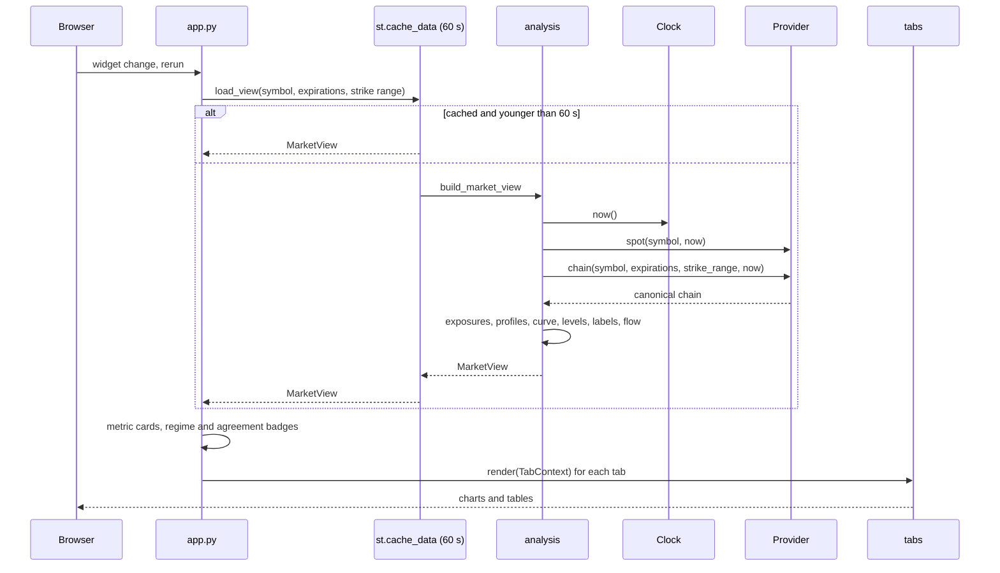

# Architecture

## Modules

```text
src/gex_dashboard/
├── app.py              sidebar, one MarketView per run, metric cards, badges, tab dispatch
├── __main__.py         gex-dashboard: streamlit run app.py, passing extra arguments on
├── config.py           Settings from environment variables; make_clock
├── clock.py            Clock protocol (System, Fixed, Replay); sessions and trading time
├── providers/
│   ├── base.py             ChainProvider protocol, Capability flags, canonical columns, ProviderError
│   ├── __init__.py         registry keyed by GEX_PROVIDER; create_provider
│   ├── synthetic.py        seeded Black-Scholes-Merton market (the default)
│   └── convexvalue.py      ConvexValue adapter; convexlib imported lazily
├── bsm.py              Black-Scholes-Merton price and greeks, vectorized, textbook units
├── exposures.py        dealer sign, greeks to dollar exposures, per-strike profiles,
│                       GEX repriced across spot (gex_curve), strike x expiration grids
├── levels.py           gamma flip, call/put walls, vanna flip, vega peaks, ATM IV,
│                       expected move, the TradingView levels string
├── profiles.py         gamma regime, GEX/vanna alignment, index agreement, hedging impact
├── patterns.py         GEX ladder: strike classification, structure, clusters, saturation
├── flow.py             customer net flow (volume, premium, delta, gamma); volume spikes
├── simulation.py       Monte Carlo paths with GEX-dependent volatility
├── analysis.py         MarketView and build_market_view: one snapshot, every derived value
├── formatting.py       compact dollars, expiration labels, distance from spot
├── charts/             Plotly figures (profile, heatmap, flow, volume, ladder, simulation, style)
├── tabs/               one module per tab, each with render(ctx: TabContext)
└── ui/
    ├── agreement.py        scope_regimes: each symbol's regime for the index-agreement badge
    ├── context.py          TabContext; capability messages for tabs
    └── errors.py           the ProviderError boundary app.py runs provider calls in
```

Imports point one way. The core (`bsm`, `clock`, `exposures`, `levels`,
`profiles`, `patterns`, `flow`, `simulation`, `analysis`, `providers`) has no
Streamlit or Plotly import. `charts` builds figures from core results and
imports no Streamlit. Only `app.py`, `tabs` and `ui` import Streamlit. The
synthetic provider and `exposures.gex_curve` both use `bsm`; nothing in the
core reads the wall clock except `clock.SystemClock`.

## Data flow



`build_market_view` reads the clock **once** and passes that instant to both
`spot` and `chain`, so spot, the chain, the expected move and the gamma flip
all describe the same moment. `analyze_chain` then:

0. `unexpired`: drops contracts whose expiration closed at or before `now`
   (`clock.is_expired`), so a same-day expiration a live source still lists
   after 16:00 counts nowhere; see
   [DESIGN.md](DESIGN.md#expired-contracts).
1. `exposures.contract_exposures`: adds `dealer_sign` and one dollar column
   per greek to every contract. This is the only unit conversion.
2. `gex_by_strike`, `vanna_profile`, `charm_profile`, `vega_profile`: sums
   per strike.
3. `gex_curve`: net GEX repriced at 201 prices across spot ±10%.
4. `levels`: the gamma flip from the curve (with a note saying why when
   there is none), walls from the GEX profile, the vanna flip, vega peaks,
   and the front (nearest unexpired) expiration's ATM IV and expected move.
5. `profiles`: the gamma regime, GEX/vanna alignment and hedging impact.
6. `flow.net_delta_flow`: customer net dollar delta, when the chain has
   flow columns.

The result is a frozen `MarketView`. Tabs receive it in a `TabContext`
together with the provider's capabilities and do only light, tab-specific
work on it (the ladder's window and labels, heatmap grids, the simulation).

## Provider protocol

```python
class ChainProvider(Protocol):
    name: str
    capabilities: Capability

    def spot(self, symbol: str, now: datetime | None = None) -> float: ...
    def expirations(self, symbol: str, now: datetime | None = None) -> list[date]: ...
    def chain(
        self,
        symbol: str,
        expirations: Sequence[date] | None = None,
        strike_range: float = 0.10,
        now: datetime | None = None,
    ) -> pd.DataFrame: ...
```

`chain` returns one row per contract with the canonical columns in
`providers/base.py`. Every row has `expiration, strike, right, bid, ask,
last, volume, open_interest, iv, delta, gamma, vega, theta`. The capability
flags add columns and features:

| Capability | Adds | Used by |
|---|---|---|
| `MULTI_EXPIRATION` | `chain(expirations=None)` returns every expiration | the "All expirations" choice, the Exposure Heatmap, Customer Flow by Expiration |
| `SECOND_ORDER` | `vanna`, `charm` | vanna flip, vanna and charm heatmaps, regime refinement, GEX/vanna alignment, hedging impact |
| `FLOW` | `volume_buy`, `volume_sell`, `premium_buy`, `premium_sell` | customer net delta, Customer Flow by Expiration, the buy/sell split in Volume Spikes |

Units are per share, as in a vendor chain: gamma per $1 of spot, vega and
vanna per volatility point, theta and charm per trading day. A value the
source does not supply is NaN, never 0; the count columns are 0 when
missing. A provider never computes exposures; the core does. A provider
signals any failure (network, login, missing package, bad payload) by raising
`ProviderError`.

`providers/__init__.py` maps `GEX_PROVIDER` to a factory. The ConvexValue
factory imports its module only when chosen, and that module imports
`convexlib` only when the provider is constructed, so the package and its
tests run without it.

`tests/unit/test_provider_contract.py` runs the same contract against every
registered provider: the protocol is satisfied, spot is a positive float,
expirations are sorted unique dates, the chain has exactly the canonical
columns for its capabilities with the right types, strikes stay within the
range, asking for one expiration returns only that one, and a market view
can be built from it. The ConvexValue provider runs against an in-memory fake
`convexlib` (`tests/unit/fake_convexlib.py`) fed with a synthetic chain.

## The clock

`clock.Clock` is a protocol with one method, `now()`, returning an aware
datetime. Three implementations, chosen by `GEX_CLOCK`:

| Clock | Behaviour | Used for |
|---|---|---|
| `SystemClock` | the wall clock, in New York time | live providers (the default when `GEX_PROVIDER` is not synthetic) |
| `FixedClock` | stopped at `GEX_CLOCK_START` | tests and reproducible screenshots |
| `ReplayClock` | starts at `GEX_CLOCK_START` (default 10:30 New York time on the latest weekday), runs at `GEX_CLOCK_SPEED`, and loops inside that session: at 16:00 it wraps to 09:30 | the synthetic demo (the default) |

A replay start outside a session rolls forward to the next 09:30 open. The
clock is created once per settings (see caching below), so the replay
advances between reruns.

`clock.py` also holds the session arithmetic: regular sessions are 09:30 to
16:00 New York time, Monday to Friday, and an option expires at 16:00 on its
expiration date. `years_to_expiry` counts trading minutes and divides by
252 × 390; see [DESIGN.md](DESIGN.md#trading-time). Exchange holidays are not
modelled.

## Caching in the app

| Cache | Key | Lifetime | Holds |
|---|---|---|---|
| `st.cache_resource` `market_source` | `repr(settings)` | the process | the clock and the provider (so a ConvexValue login and the replay clock persist across reruns) |
| `st.cache_data` `load_expirations` | provider key, symbol (the `now` passed in is not part of the key) | 60 s | the expiration list |
| `st.cache_data` `load_view` | provider key, symbol, expirations, strike range, rate | 60 s | the `MarketView` |

The provider key is `"<name>:<id(provider)>"`, so a new provider instance
never reuses another's cached views. Within 60 seconds, widget changes that
don't change the key (a tab's radio or slider) re-render from the cached
view without refetching the chain. **Refresh data** clears both data caches.
`main` reads the clock once per run for the sidebar and passes that `now` to
`load_expirations`; `open_expirations` then drops any expiration that has
closed by that instant, on every run, since the cached list can be up to a
minute old. With several symbols configured, the index-agreement badge
needs a view per symbol in the main view's scope. `ui.agreement.scope_regimes`
gathers them (loading) and `app.index_agreement_badge` draws the badge
(rendering): with all expirations it reuses the main view for the current
symbol and loads the others' whole chains; with a single expiration it loads
each symbol's front expiration, reusing the main view when it is that
front.
Both go through the same cache, so switching symbols right after is served
from it.

Nothing is cached outside these calls, and nothing is written to disk. In
particular the expected move is recomputed from the chain on every view
build, so it always matches the chain on screen.

## Failure handling

`ui.errors.provider_errors` wraps provider construction, the expiration list
and the view build. A `ProviderError` there shows one error naming the data
source and what failed, then stops the run; there is no traceback. An empty
expiration list and a chain without open interest get their own messages.
A tab whose capability is missing shows an `st.info` naming what the data
source does not supply (`ui.context.require`). The index-agreement badge
treats a symbol whose provider call fails as unavailable instead of failing
the page.

## Docker

The image is a two-stage build on a digest-pinned `python:3.14-slim`, with
dependencies installed by uv from `uv.lock`. Only the virtualenv is copied
into the runtime stage, owned by root; the app runs as the non-root user
`dashboard`. `CMD` is `gex-dashboard --server.address=0.0.0.0 --server.port=8501`,
and the image's `HEALTHCHECK` polls Streamlit's `/_stcore/health`; it is the
only healthcheck, and the one `docker compose up --wait` (and the CI
`docker` job) waits on. `docker-compose.yml` has a single service, `app`, on
the synthetic provider with the replay clock, published on
`127.0.0.1:${DEMO_APP_PORT:-8501}`. There is no database.

## Testing

| Layer | Where | What it shows |
|---|---|---|
| Unit | `tests/unit` | BSM greeks against finite differences; trading time and the clocks; exposure units and signs; the gamma flip, walls and other levels; ladder rules; flow; the simulation; config parsing; the synthetic market's shape and determinism; the ConvexValue mapping against a fake `convexlib`; chart construction |
| Contract | `tests/unit/test_provider_contract.py` | every registered provider meets the protocol |
| Page | `tests/pages/test_pages.py` | the whole app under Streamlit's `AppTest`: every tab at several clock times, every symbol, tab controls, refresh, capability gating with a reduced provider, provider failures, an empty chain, and ConvexValue through the fake |
| Demo | CI `docker` job | a clean checkout builds and serves a healthy app, and the installed app renders every tab without an error inside the image |

No test makes a network call. CI runs every layer; see
[CONTRIBUTING.md](../CONTRIBUTING.md).
